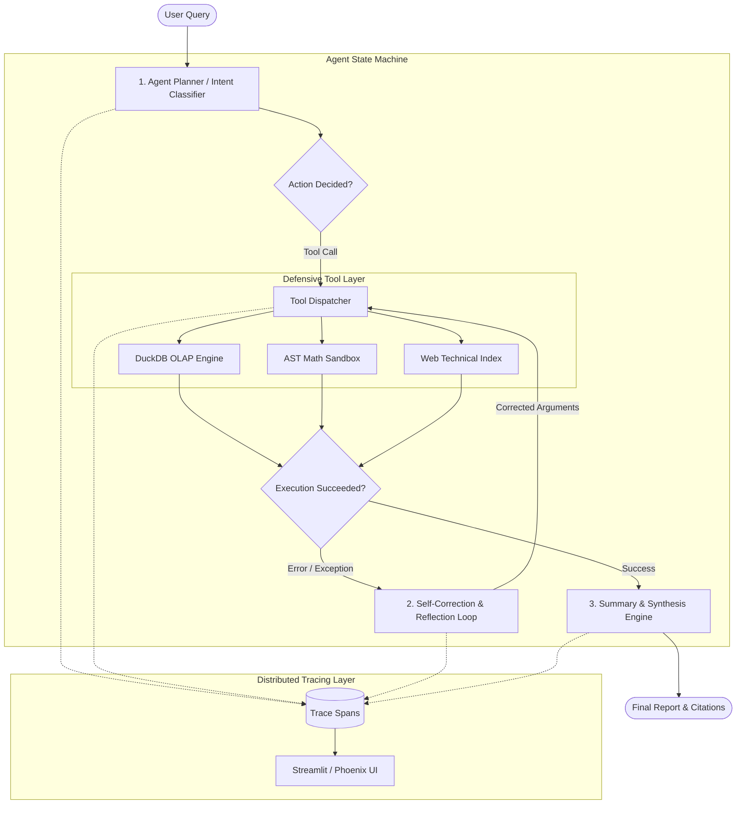

# ⚡ Agent-Trace-Ops

[](https://github.com/your-username/agent-trace-ops/actions)


> **Autonomous Agentic Workflow Assistant with In-Memory DuckDB Analytics, Defensive Tool Execution, and OpenTelemetry-Style Distributed Tracing.**

---

## 📌 Executive Overview

Most beginner AI repositories are thin wrappers around linear LLM prompt chains that fail silently on schema errors and lack observability. 

**`agent-trace-ops`** is engineered as a production-grade agent framework demonstrating:
1. **Deterministic State-Machine Workflow:** Multi-step loop with planning, tool invocation, and reflection.
2. **Defensive Tool Execution:** AST-parsed arithmetic sandbox (eliminating `eval()` vulnerabilities) and SQL mutation guardrails on DuckDB.
3. **Automated Self-Correction:** When a tool encounters an execution error (e.g. invalid column name or syntax exception), the agent reflects on the error payload, self-corrects the inputs, and retries.
4. **End-to-End Distributed Tracing:** Generates OpenTelemetry-compliant execution spans measuring per-step duration, prompt/completion token consumption, and dollar cost attribution.

---

## 🏛️ System Architecture



---

## 🚀 Key Technical Features

### 1. In-Memory OLAP Analytics (`DuckDB`)
* Ships with an in-memory database of tech and AI investment rounds.
* LLMs can introspect table schemas (`DESCRIBE tech_investments`) and run aggregations, group-bys, and filters.
* **Security Guardrails:** Strictly prohibits mutation statements (`DROP`, `DELETE`, `UPDATE`, `ALTER`, `ATTACH`).

### 2. Zero-Vulnerability Math Engine (`ast` Parser)
* Evaluates dynamic arithmetic expressions strictly by traversing Python's Abstract Syntax Tree (`ast.BinOp`, `ast.Constant`).
* Completely mitigates Remote Code Execution (RCE) vectors inherent to standard `eval()`.

### 3. Self-Correction & Error Recovery
* Tools return typed error envelopes rather than uncaught exceptions.
* The agent detects failure payloads, analyzes root causes, and executes a targeted retry before returning a partial failure.

### 4. Telemetry & Cost Accounting
* Every run generates an `ExecutionTrace` with discrete `SpanRecord` objects.
* Tracks:
  * Execution latency per node in milliseconds
  * Prompt & completion token counters
  * Model pricing calculations per 1M tokens

---

## 📂 Repository Structure

```
agent-trace-ops/
├── .github/
│   └── workflows/
│       └── ci.yml             # GitHub Actions automated lint & test runner
├── data/
│   └── sample_tech_investments.csv # Verified analytical dataset
├── src/
│   ├── agent/
│   │   ├── graph.py           # Core agent state machine & self-correction loop
│   │   ├── state.py           # Pydantic agent models & execution memory
│   │   ├── prompts.py         # System directives & reflection prompts
│   │   └── tools/
│   │       ├── calculator.py  # AST-based safe math sandbox
│   │       ├── sql_analytics.py # DuckDB query engine & schema inspector
│   │       ├── web_search.py  # Technical doc search tool
│   │       └── registry.py    # Dynamic tool registration & schema generator
│   ├── api/
│   │   └── main.py            # FastAPI backend with OpenAPI /docs
│   ├── observability/
│   │   └── tracer.py          # Distributed tracing spans & cost tracker
│   └── ui/
│       └── app.py             # Streamlit visual dashboard
├── tests/
│   ├── test_tools.py          # Unit tests for tools & security policies
│   ├── test_agent.py          # State graph & self-correction tests
│   └── test_api.py            # FastAPI endpoint tests
├── docker-compose.yml         # Container orchestration (App + Arize Phoenix)
├── Dockerfile                 # Production multi-stage container
├── requirements.txt           # Pinned dependencies
└── README.md                  # System design & documentation
```

---

## ⚡ Quickstart

### Option A: Run with Docker Compose (Recommended)

```bash
# Clone the repository
git clone https://github.com/your-username/agent-trace-ops.git
cd agent-trace-ops

# Start the agent and Phoenix observability UI
docker compose up --build
```
* **Interactive UI:** Open [http://localhost:8501](http://localhost:8501)
* **FastAPI Docs:** Open [http://localhost:8000/docs](http://localhost:8000/docs)
* **Phoenix Traces:** Open [http://localhost:6006](http://localhost:6006)

---

### Option B: Local Virtual Environment

```bash
# Create and activate virtual environment
python -m venv venv
source venv/bin/activate  # On Windows: venv\Scripts\activate

# Install dependencies
pip install -r requirements.txt

# Run test suite
pytest tests/ -v

# Launch the FastAPI server
uvicorn src.api.main:app --reload --port 8000

# In a separate terminal, launch the Streamlit frontend
streamlit run src/ui/app.py
```

---

## 🧪 Testing & Code Quality

The test suite runs automatically on every pull request via GitHub Actions:

```bash
pytest tests/ -v
```

Test coverage includes:
* **Tool security:** Ensuring arbitrary code injection and SQL mutations are blocked.
* **Agent resilience:** Verifying fallback triggers when queries fail.
* **API contracts:** Ensuring FastAPI endpoints strictly adhere to schemas.

---

## 💬 System Design Interview FAQ (Talking Points)

<details>
<summary><strong>Q: Why use DuckDB instead of Pandas for agent analytical tools?</strong></summary>

> **Answer:** DuckDB uses a vectorized columnar query execution engine that is significantly more memory-efficient and faster than Pandas on analytical workloads. Furthermore, exposing standard SQL syntax enables LLMs to leverage their existing SQL pretraining rather than having to generate fragile Python DataFrame method chains.
</details>

<details>
<summary><strong>Q: How do you prevent arbitrary code execution when the agent runs math?</strong></summary>

> **Answer:** Standard implementations often rely on `eval()`, exposing the server to severe injection risks (`__import__('os').system(...)`). We constructed an AST visitor (`src/agent/tools/calculator.py`) that strictly permits explicit arithmetic binary operators (`+`, `-`, `*`, `/`) and rejects any unauthorized node types.
</details>

<details>
<summary><strong>Q: How does the agent handle hallucinations or invalid tool arguments?</strong></summary>

> **Answer:** Rather than failing the user request, the agent implements a reflection node. The tool catches execution exceptions, wraps them into a structured error envelope, and feeds the error trace back into the planning prompt to compute an updated, valid invocation.
</details>

---

## 📄 License
Released under the [MIT License](LICENSE).
